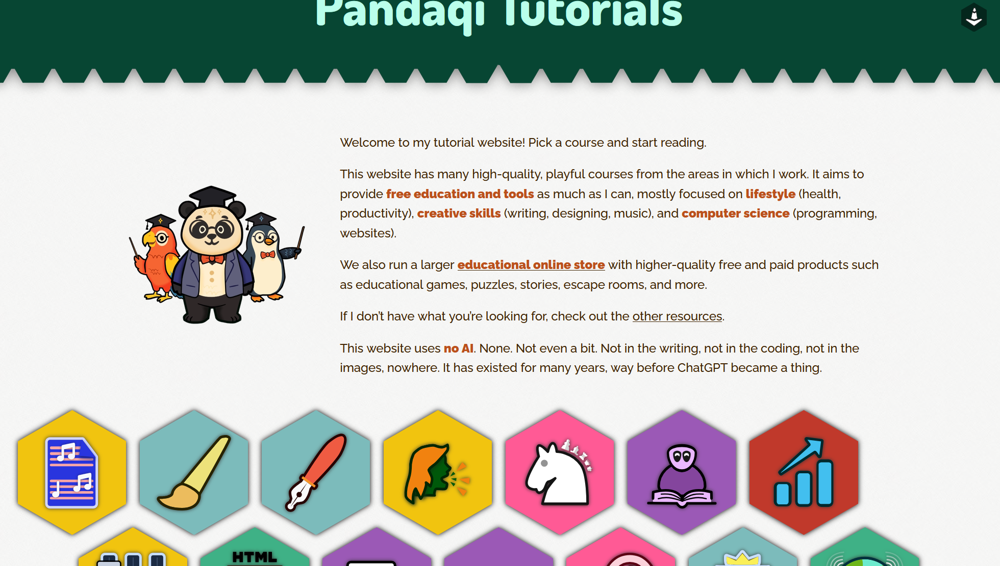
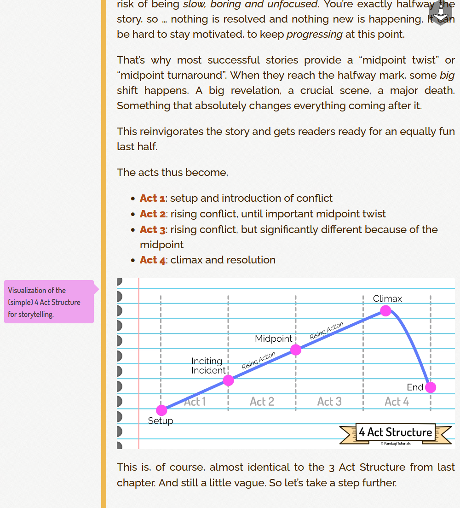

# Pandaqi Tutorials

This is the full source code / project behind [Pandaqi Tutorials](https://pandaqi.com/tutorials/).

## What Is This?

This is my oldest website (still online/alive today). 

For years I wrote large **in-depth courses** about any topic I thought I could help people with. Making it a website was easy for accessibility, updates, and **adding interactive features** (like widgets, videos, quizzes, etcetera)---which are way better for learning than reading text!

So, as it stands,

* It's a free website with some **40 complete courses** on a range of topics (writing, coding, music, skills, life hacks, etc.)
* Each course is split into 10--30 **short bite-sized chapters**. 
* Wherever possible, the course uses **images** and **interactive widgets** to aid learning.
* The entire website is **human-made**. The writing, the images, the code, literally everything was made by me by hand. Kind of hard to use AI, of course, in the 8 years this website existed before AI existed ;)
* All of this without ads, or accounts, or trying to sell you stuff, or even tracking any analytics about visitors.

## Project Architecture

It's made using Hugo. This means it's a static website that I rebuilds automatically whenever this repository updates.

The actual website is inside `pandaqi-tutorials`. Everything else is metadata or supportive documents for the project.

Nothing is hidden or changed for this public version. It's the actual website, as I build and host it. 

I'm open sourcing all my websites in an effort towards an open world based on sharing and transparency. It's the least I can do.

## Roadmap

Several more courses and tools/widgets are planned. 

But ... things are different than 10+ years ago, when this started. AI is everywhere now. Anyone can ask it to just copy my work and write an entire course using slightly different language. Anyone can just ask their chat _directly_ to explain a topic.

I do not see the value in manually creating these entire courses anymore :/ They take a _massive_ amount of work for too little gain now.

I decided to **keep Pandaqi Tutorials 100% AI-Free**. I won't pollute it with AI writing or AI-coded widgets. It's nice for what it is, and it will stay that way.

I've used all I learned writing tutorials and teaching to ... actually become a teacher. I have a large educational online store now, I'm working on a large curriculum, but yes, that work is AI-assisted now. So that work will _not_ be part of this project.